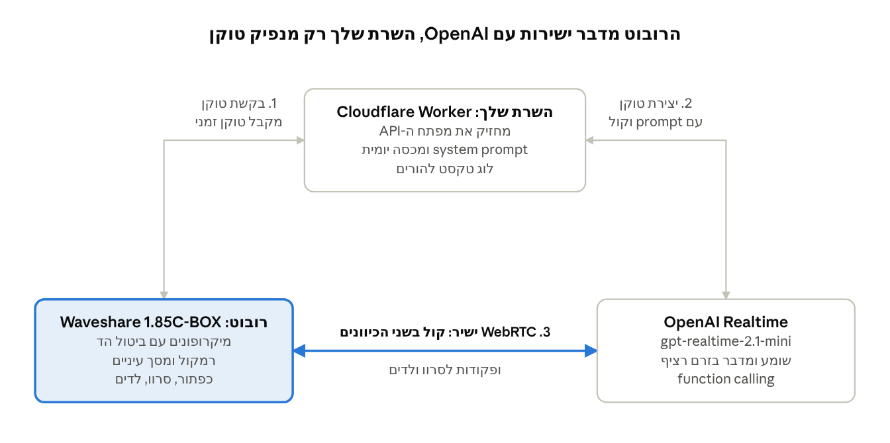

# רובוט AI מדבר לילדים - אפיון ותוכנית עבודה

Oct 27, 2026 · @or am shalem

## תקציר

בונים רובוט שולחני קטן שמנהל שיחה קולית בעברית עם ילדים מגיל 4 עד 10. הרובוט עצמו הוא "אוזניים, פה ופנים" על ESP32-S3, והמוח הוא מודל speech-to-speech בענן (OpenAI Realtime או Gemini Live) שמתחבר דרך Wi-Fi.

עקרונות מנחים:

- ענן קודם, מקומי אחר כך. מודלים מקומיים קטנים עדיין חלשים בעברית ואיטיים.

- שלבים קטנים עם שער אישור. כל שלב נגמר בתוצר שעובד ונבדק, ורק אחרי אישור עוברים לשלב הבא.

- בטיחות ילדים מהיום הראשון. system prompt קשיח, הגבלת זמן ולוג להורים יושבים בשרת, לא בלוח.

- מפתחות לא על החומרה. הלוח מקבל טוקן זמני בלבד.

- לוח מוכן לפני הלחמות. מתחילים עם לוח Waveshare מורכב מהמפעל, בלי הלחמות ובלי חיווט.

יעד ראשון: רובוט שעונה בעברית תוך פחות משנייה וחצי, עם עיניים על מסך, בעלות חומרה של כ-150 ₪.

## אפיון מוצר

הרובוט צריך להרגיש כמו חבר קטן וסקרן, לא כמו רמקול חכם. כל דרישה כאן נבדקת בשלב שמופיע בעמודה האחרונה.

### דרישות פונקציונליות

| \#  | דרישה                                                          | עדיפות | נבדק בשלב |
|-----|---------------------------------------------------------------------------------------|-------------------------------|----------------------------------|
| F1  | שיחה קולית רציפה בעברית, כולל קטיעה באמצע תשובה                | חובה   | 4                                |
| F2  | כשהוא דלוק הוא מקשיב כל הזמן, בלי כפתור. לחץ ודבר נשאר כאפשרות | חובה   | 4                                |
| F3  | עיניים מונפשות על המסך: מקשיב, חושב, מדבר, ישן                 | חובה   | 5                                |
| F4  | דמות קבועה עם שם, אופי וקול עקבי                               | חובה   | 1                                |
| F5  | פעולות פיזיות דרך function calling: הנהון, צבע לדים, הבעת פנים | רצוי   | 5                                |
| F6  | משחקים קוליים קצרים: חידות, ספירה, "מה החיה עושה"              | רצוי   | 5                                |
| F7  | זיכרון קצר על הילד (שם, גיל, מה אוהב) שההורה מגדיר             | רצוי   | 6                                |
| F8  | הודעת "אני ישן עכשיו" מוקלטת מראש כשאין אינטרנט או מחוץ לשעות  | חובה   | 6                                |

### דרישות לא פונקציונליות

| נושא         | יעד                                                                     |
|-------------------------------------|------------------------------------------------------------------------------------------------|
| זמן תגובה    | עד 1.5 שניות מסוף דיבור הילד עד תחילת תשובה                             |
| אורך תשובה   | 1 עד 3 משפטים קצרים, בערך 15 שניות                                      |
| סוללה        | לפחות שעתיים שיחה פעילה, טעינה ב-USB-C                                  |
| עלות שוטפת   | עד 30 ₪ בחודש בשימוש של 20 דקות ביום                                    |
| בטיחות תוכן  | אין נושאים לא מתאימים, הפניה להורה בשאלות רגישות, אין איסוף פרטים מזהים |
| פרטיות       | אין שמירת אודיו, לוג טקסט בלבד שזמין רק להורה                           |
| בקרת הורים   | מכסת דקות יומית, שעות פעילות, כיבוי מרחוק                               |
| עמידות פיזית | שורד נפילה מגובה שולחן, בלי חלקים קטנים שנתלשים                         |

## ארכיטקטורה

המודל לא רץ על הרובוט. הלוח מתחבר ל-Wi-Fi של הבית, מקבל טוקן זמני מהשרת שלך, ומשם מדבר ישירות עם OpenAI.

ארכיטקטורה · רובוט, שרת טוקנים, OpenAI

זרימה בפועל:

1.  הדלקה: הלוח מתחבר ל-Wi-Fi.

2.  טוקן: הלוח שולח מזהה מכשיר וסוד ל-Worker. ה-Worker בודק מכסה ושעות, יוצר client secret זמני ב-OpenAI עם ה-prompt והקול, ומחזיר אותו.

3.  שיחה: הלוח פותח חיבור WebRTC ישיר ל-OpenAI. אודיו OPUS זורם בשני הכיוונים, וקטיעה עובדת בזכות AEC בלוח.

4.  פעולות: המודל קורא לפונקציות כמו nod או set_leds. ההודעה מגיעה בערוץ הנתונים של אותו חיבור, והלוח מבצע.

5.  לוג: בסוף שיחה הלוח שולח את התמלול ל-Worker, שנשמר ב-D1 לצפיית ההורה.

בלי אינטרנט הרובוט משמיע הודעה מוקלטת מראש ולא מנהל שיחה.

## מודלים ושירותים

ההמלצה: gpt-realtime-2.1-mini כספק ראשי, עם Gemini Live כחלופה שנבדקת בשלב 1. ההחלטה הסופית מתקבלת בשער של שלב 1 לפי איכות העברית בבדיקה עם הילדים.

| אפשרות                                                                           | למה כן                                                                          | למה לא                                                   | עלות משוערת                                                                                                        |
|---------------------------------------------------------------------------------------------------------|--------------------------------------------------------------------------------------------------------|---------------------------------------------------------------------------------|-------------------------------------------------------------------------------------------------------------------------------------------|
| [OpenAI gpt-realtime-2.1-mini](https://datanorth.ai/news/openai-releases-gpt-realtime-2-1-voice-models) | דוגמה רשמית ל-ESP32 של Espressif עם WebRTC ו-AEC, function calling, קטיעה טבעית | מבטא עברי סביר אבל לא מושלם, מגוון קולות מצומצם          | נמוכה מהגרסה המלאה. הגרסה המלאה בערך 15 עד 20 סנט לדקה ([מקור](https://rywalker.com/research/openai-realtime-api)) |
| [Gemini 3.8 Live](https://tech-insider.org/?p=27466)                                                    | שכבה חינמית, עברית טובה ב-LLM                                                   | אין דוגמת ESP32 רשמית, דורש חיבור WebSocket דרך שרת      | חינם בשכבה החינמית, אחר כך לפי שימוש                                                                               |
| [ElevenLabs Agents](https://www.cekura.ai/blogs/elevenlabs-review)                                      | איכות הקול הכי טובה, אפשר קול מותאם לדמות, בחירת LLM                            | יקר יחסית, אין דוגמת ESP32 רשמית                         | 8 עד 10 סנט לדקה ([מקור](https://resources.rework.com/tools/ai-agents/best-ai-voice-agents-2026))                  |
| מקומי (Whisper + DictaLM + TTS על מחשב בבית)                                     | בלי עלות שוטפת, פרטיות מלאה                                                     | עברית חלשה יותר, latency של 2 עד 4 שניות, דורש מחשב דלוק | חשמל בלבד                                                                                                          |

חישוב עלות לדוגמה: 20 דקות ביום כפול 30 ימים הם 600 דקות בחודש. במחיר הגרסה המלאה זה בערך 90 עד 120 ₪, ולכן מתחילים ב-mini ובודקים מחיר אמיתי בלוח הבקרה של OpenAI אחרי שבוע שימוש.

מה בודקים בשלב 1 לכל ספק:

- הגייה של שמות ילדים ומילים בסיסיות

- הבנת דיבור של ילד בן 5 (משפטים חלקיים, הגייה לא מדויקת)

- זמן תגובה מורגש

- עמידה ב-system prompt כשהילד מנסה "לשבור" אותו

## חומרה וציוד פיזי

ההמלצה: Waveshare ESP32-S3-Touch-LCD-1.85C-BOX עם סוללה, בערך 130 ₪. לוח מורכב לגמרי עם מסך מגע עגול לעיניים, מיקרופון, קופסת רמקול וסוללה. מחברים USB-C וצורבים, בלי הלחמה ובלי חיווט.

### אפשרויות, מהזול ליקר

| ערכה                                                                                                                                                                            | מה כלול                                                                   | מתאים ל                               | מחיר משוער                                                                                                        |
|--------------------------------------------------------------------------------------------------------------------------------------------------------------------------------------------------------|--------------------------------------------------------------------------------------------------|--------------------------------------------------------------|------------------------------------------------------------------------------------------------------------------------------------------|
| [M5Stack Atom EchoS3R](https://thepihut.com/products/atom-echos3r-smart-speaker-dev-kit)                                                                                                               | ESP32-S3 עם 8MB PSRAM, מיקרופון, רמקול 1W, כפתור. 24×24 מ"מ                                      | הכנסה לתוך בובה או דובי קיים. אין מסך | \$14.5 ([מקור](https://octopart.com/manufacturers/m5stack?start=510)). כ-55 ₪                                     |
| [Waveshare ESP32-S3-Touch-LCD-1.46](https://www.waveshare.com/product/arduino/displays/lcd-spi-qspi.htm)                                                                                               | מסך עגול 412×412, רמקול ומיקרופון על הלוח                                 | הכי זול עם מסך. צריך מארז             | \$22 עד \$27. כ-90 ₪                                                                                              |
| [Waveshare ESP32-S3-Touch-LCD-1.85C-BOX](https://www.cnx-software.com/2025/03/31/esp32-s3-smart-audio-devkit-integrates-1-8-inch-round-touch-lcd-microphone-optional-battery-and-speaker-box/) (מומלץ) | מסך מגע עגול 360×360, מיקרופון, קופסת רמקול 2W, סוללה 3.7V בגרסה עם סוללה | רובוט קטן עם פנים, מוכן לשימוש        | \$32 עד \$36 ([מקור](https://www.waveshare.com/product/esp32-related/boards-kits/esp32-s3.htm?dir=desc)). כ-130 ₪ |
| [M5Stack StackChan](https://github.com/m5stack/StackChan)                                                                                                                                              | רובוט שלם עם 2 סרוו, לדים, מסך, סוללה                                     | שדרוג בעתיד, אם רוצים תנועת ראש       | \$99. כ-370 ₪                                                                                                     |

כל הלוחות האלה נתמכים בפרויקט xiaozhi-esp32, כך שיש קוד מוכן למסך, לאודיו ולסוללה.

### מה עוד צריך

- כבל USB-C לנתונים

- אופציונלי: אוזניים, כובע או "ראש" מודפס שמתלבש על הקופסה העגולה, בלי לגעת באלקטרוניקה

אין צורך במלחם, מולטימטר או חוטים.

סה"כ משוער: כ-150 ₪ כולל משלוח. לקנות בחנות הרשמית של Waveshare באלי, ולשקול לחכות ל-11.11.

## פרויקטים דומים בגיטהאב

הבסיס הכי קרוב לפרויקט הוא ElatoAI. כדאי לשכפל אותו ולשנות, במקום לכתוב הכל מאפס.

| פרויקט                                                                                                                      | מה הוא                                                                       | מה לקחת                                                                                                                                                                                                                                                                                                   |
|----------------------------------------------------------------------------------------------------------------------------------------------------|-----------------------------------------------------------------------------------------------------|----------------------------------------------------------------------------------------------------------------------------------------------------------------------------------------------------------------------------------------------------------------------------------------------------------------------------------|
| [ElatoAI](https://developers.openai.com/cookbook/examples/voice_solutions/running_realtime_api_speech_on_esp32_arduino_edge_runtime_elatoai)       | צעצוע AI קוד פתוח על ESP32-S3 עם OpenAI Realtime. מופיע ב-Cookbook של OpenAI | ארכיטקטורה מוכנה: ESP32 בארדואינו, WebSocket מאובטח לשרת Edge, OPUS, דמויות וקולות, תמלולים ב-Supabase, אפליקציית ניהול לטלפון ([מקור](https://reddit.birdcat.cafe/r/ArduinoProjects/duplicates/1k586h0)). תומך היום ביותר מ-100 מודלים ([מקור](https://gittrend.io/repo/akdeb/ElatoAI)), כלומר גם Gemini |
| [OpenToys](https://github.com/akdeb/OpenToys)                                                                                                      | הגרסה המקומית של ElatoAI, רצה על מק                                          | אם בעתיד תרצה מקומי: Whisper, Qwen3-TTS, שכפול קול מ-10 שניות הקלטה                                                                                                                                                                                                                                       |
| [xiaozhi-esp32](https://github.com/cube32esp/xiaozhi-esp32)                                                                                        | הפרויקט הגדול בתחום, MIT                                                     | רשימת לוחות נתמכים (כולל BOX-3, CoreS3, AtomS3R), אנימציות פנים, ניהול סוללה, שליטה בחומרה דרך MCP. אפשר להריץ שרת משלך עם xiaozhi-esp32-server בפייתון                                                                                                                                                   |
| [AI StackChan Ex](https://github.com/burrsutter/AI_StackChan_Ex)                                                                                   | קושחה קהילתית ל-StackChan                                                    | תמיכה מובנית ב-Realtime API על CoreS3, MCP, ומבנה "מודים" שמחליפים בהחלקה על המסך                                                                                                                                                                                                                         |
| [Stack-chan](https://github.com/stack-chan/stack-chan)                                                                                             | הפרויקט המקורי של הרובוט                                                     | כלי צריבה מהדפדפן בלי סביבת פיתוח, הבעות פנים ותנועות                                                                                                                                                                                                                                                     |
| [ESP-Brookesia chatbot](https://components.espressif.com/components/espressif/brookesia_service_audio/versions/0.7.4/examples/chatbot?language=en) | דוגמה רשמית של Espressif                                                     | מילת הפעלה ו-VAD מובנים, הבעות פנים לפי מצב, החלפה בין OpenAI לסוכנים אחרים. רץ על BOX-3                                                                                                                                                                                                                  |

דברים חשובים שעלו מהפרויקטים האלה:

- **WebSocket דרך השרת שלך עדיף על WebRTC ישיר** כשרוצים להחליף ספק בקלות. ElatoAI עושה את זה, וכך אפשר לעבור בין OpenAI ל-Gemini בלי לגעת בקושחה.

- תמלולים בבסיס נתונים נותנים את לוג ההורים כמעט בחינם.

- אפליקציה לטלפון לניהול דמות, ווליום ומכשירים חוסכת מסך הגדרות על הרובוט.

- לא להשאיר את הקושחה המקורית על StackChan או ערכות XiaoZhi. היא שולחת קול לשרתים בסין, וזה לא מתאים לילדים.

## הוזלת עלויות

החיסכון הגדול הוא בשימוש השוטף, לא בחומרה. עם Gemini Live בשכבה החינמית ומכסה יומית, העלות החודשית יכולה לרדת כמעט לאפס.

### חומרה

- ערכה אחת במקום רכיבים: לוח Waveshare 1.85C-BOX בכ-130 ₪ מחליף לוח, מסך, מיקרופון, רמקול, סוללה ומארז. בלי שגיאות חיווט ובלי לקנות מלחם.

- בלי לוח רזרבי אם הולכים על ערכה מוכנה. הצריבה דרך USB בטוחה וניתנת לשחזור.

- מסלול חסכוני: Atom EchoS3R בכ-55 ₪, מוכנס לתוך בובה או צעצוע שכבר יש בבית.

- לקנות מהחנות הרשמית של Waveshare או M5Stack ב-AliExpress ולחכות למבצעים (11.11 בנובמבר קרוב).

### שימוש ב-API

- **Gemini Live כברירת מחדל** דרך השרת שלך, בשיטה של ElatoAI. יש שכבה חינמית ([מקור](https://tech-insider.org/?p=27466)). OpenAI נשאר כגיבוי אם העברית שלו נשמעת טוב יותר.

- **gpt-realtime-2.1-mini ולא הגרסה המלאה** אם בוחרים ב-OpenAI.

- מיקרופון פתוח כל עוד הרובוט דלוק (הוחלט במקום לחץ ודבר). כדי לא לשלם על שקט ועל רעשי רקע: מצב שינה אחרי זמן בלי דיבור, שמתעורר כשהלוח מזהה קול. נבנה בשלב 4.

- ניתוק אוטומטי אחרי 20 שניות בלי דיבור.

- **prompt קבוע וקצר** כדי ליהנות מ-caching של קלט, שזול פי 80 בגרסה המלאה (\$0.40 מול \$32 למיליון טוקנים, [מקור](https://www.forasoft.com/blog/article/openai-realtime-api-pricing)).

- תשובות קצרות ב-prompt. אודיו יוצא הוא החלק היקר.

- מכסה יומית בשרת ומגבלת הוצאה חודשית בחשבון.

- **ElevenLabs רק אם חייבים קול מיוחד:** החינמי שלהם כ-15 דקות בחודש בלבד ([מקור](https://www.cekura.ai/blogs/elevenlabs-review)).

## חשבונות, הגדרות וסביבת פיתוח

הכל מוכן עד סוף שלב 3, לפני שהחומרה נדלקת בפעם הראשונה.

### חשבונות

| שירות | מה צריך                                  | הגדרה חשובה                                                    |
|------------------------------|-----------------------------------------------------------------|---------------------------------------------------------------------------------------|
| OpenAI Platform              | חשבון עם אמצעי תשלום, פרויקט נפרד לרובוט | מגבלת הוצאה חודשית (Usage limit) של 10 עד 15 דולר והתראה ב-50% |
| Google AI Studio             | מפתח Gemini API לבדיקת החלופה            | לא לחבר חיוב בשלב הבדיקה                                       |
| Cloudflare                   | חשבון חינמי ל-Workers ו-KV / D1          | Secret למפתח OpenAI, לא בקוד                                                          |
| GitHub                       | ריפו פרטי לפרויקט                        | .gitignore ל-sdkconfig ולקבצי סודות                                                   |

### סביבת פיתוח

- **ESP-IDF 5.x** דרך התוסף של VS Code או ההתקנה הרשמית לווינדוס

- **esp-webrtc-solution** של Espressif, הדוגמה openai_demo

- **Node.js + Wrangler** לפריסת ה-Worker

- **Python 3.11** לסקריפטים של בדיקות ושמע

- דרייבר USB ל-ESP32-S3 (בדרך כלל עובד מובנה בווינדוס 11)

### הגדרות בלוח (menuconfig / sdkconfig)

- SSID וסיסמת Wi-Fi

- כתובת שרת הטוקנים במקום מפתח API

- סוג הלוח: Waveshare ESP32-S3-Touch-LCD-1.85C (pinout מתוך הגדרות הלוח ב-xiaozhi)

- הפעלת AEC ו-OPUS

- PSRAM מופעל

### הגדרות בשרת (Worker)

- OPENAI_API_KEY כ-secret

- system prompt של הדמות

- שם המודל וקול נבחר

- מכסת דקות יומית ושעות פעילות

- מזהה מכשיר וסוד משותף, כדי שרק הרובוט שלך יקבל טוקן

## תוכנית עבודה

שישה שלבים, כ-4 עד 6 שבועות בעבודת ערבים. אין מעבר לשלב הבא בלי שכל תנאי השער מסומנים ויש אישור מפורש.

### שלב 1: בדיקת ספקים ודמות (ערב עד שניים)

מה עושים:

1.  כתיבת system prompt ראשון לדמות: שם, גיל, אופי, כללי בטיחות, אורך תשובה.

2.  בדיקה בפלייגראונד של OpenAI Realtime עם gpt-realtime-2.1-mini.

3.  אותה בדיקה ב-Gemini Live ב-AI Studio.

4.  10 דקות שיחה של כל ילד עם כל ספק, ורישום הערות.

תוצר: system prompt גרסה 1 וטבלת השוואה קצרה.

שער אישור:

- ☐ נבחר ספק ראשי וקול

- ☐ הילדים הבינו את הרובוט והוא הבין אותם ברוב הזמן

- ☐ ניסיון "לשבור" את הדמות נכשל ב-5 מתוך 5 ניסיונות

- ☐ אישור לעבור לשלב 2

### שלב 2: הזמנת חומרה והכנת סביבה (שבוע עד שלושה, בעיקר המתנה למשלוח)

מה עושים:

1.  הזמנת ערכת הליבה.

2.  התקנת ESP-IDF וצריבת קושחת xiaozhi המוכנה ללוח כבדיקה שהכל עובד, ואז ESP-IDF או PlatformIO.

3.  פתיחת חשבונות והגדרת מגבלת הוצאה.

תוצר: סביבת פיתוח שצורבת ללוח, חשבונות פתוחים.

שער אישור:

- ☐ הלוח מגיב לצריבה ומדפיס לוג סריאלי

- ☐ מגבלת הוצאה מוגדרת ב-OpenAI

- ☐ אישור לעבור לשלב 3

### שלב 3: שרת טוקנים (ערב)

מה עושים:

1.  Cloudflare Worker עם endpoint שמקבל מזהה מכשיר וסוד, ומחזיר client secret זמני מ-OpenAI.

2.  ה-system prompt, הקול והמודל מוגדרים בשרת.

3.  בדיקה מהמחשב עם דף HTML פשוט שמתחבר ב-WebRTC ומדבר.

תוצר: שיחה עובדת מהדפדפן דרך השרת שלך, בלי מפתח בצד הלקוח.

שער אישור:

- ☐ שיחה מהדפדפן עובדת עם הדמות

- ☐ בקשה בלי סוד נכון נדחית

- ☐ המפתח לא מופיע בשום קוד או ריפו

- ☐ אישור לעבור לשלב 4

### שלב 4: שיחה ראשונה על הרובוט (סוף שבוע)

מה עושים:

1.  קימפול openai_demo מ-esp-webrtc-solution, או שכפול ElatoAI והתאמת הפינים ללוח לפי ההגדרות של xiaozhi.

2.  החלפת זרימת המפתח בפנייה לשרת הטוקנים.

3.  כפתור "לחץ ודבר" או נגיעה במסך כהפעלה.

4.  מדידת זמן תגובה ב-20 שאלות.

תוצר: רובוט שמדבר בעברית בלי מחשב.

שער אישור:

- ☐ זמן תגובה ממוצע עד 1.5 שניות

- ☐ קטיעה באמצע תשובה עובדת

- ☐ אין הד או לולאת משוב מהרמקול

- ☐ חיבור מחדש אוטומטי אחרי ניתוק Wi-Fi

- ☐ אישור לעבור לשלב 5

### שלב 5: אופי וגוף (שבוע עד שבועיים)

מה עושים:

1.  עיניים מונפשות על המסך לפי מצב: מקשיב, חושב, מדבר, ישן.

2.  פונקציות ב-function calling: nod, set_leds, set_face.

3.  פונקציות להבעות פנים על המסך העגול במקום תנועה פיזית.

4.  אופציונלי: ראש או אוזניים מודפסים לקופסה, ובדיקת נפילה מגובה שולחן.

5.  2 עד 3 משחקים קוליים בתוך ה-prompt.

תוצר: רובוט שלם על סוללה עם אופי.

שער אישור:

- ☐ שעתיים שיחה על סוללה אחת

- ☐ המארז שרד 3 נפילות

- ☐ אין חלקים שילד יכול לתלוש

- ☐ הילדים משחקים איתו ביוזמתם

- ☐ אישור לעבור לשלב 6

### שלב 6: שכבת הורים (סוף שבוע)

מה עושים:

1.  מכסת דקות יומית ושעות פעילות ב-Worker, עם הודעת "אני ישן" מוקלטת בלוח.

2.  לוג טקסט של שיחות (תמלול בלבד) ב-D1, עם דף צפייה מוגן להורה.

3.  הגדרת פרטי הילד (שם, גיל, תחומי עניין) שנכנסים ל-prompt.

4.  כפתור כיבוי מרחוק.

תוצר: מוצר שאפשר להשאיר לילד בלי השגחה צמודה.

שער אישור:

- ☐ המכסה נאכפת וההודעה מושמעת

- ☐ הלוג מציג שיחות של היום ונגיש רק עם סיסמה

- ☐ עלות שבוע ראשון בפועל בטווח היעד

- ☐ אישור סופי

## סיכונים ונקודות פתוחות

| סיכון                                               | השפעה                   | מה עושים                                                   |
|----------------------------------------------------------------------------|------------------------------------------------|-----------------------------------------------------------------------------------|
| עברית לא טבעית או מבטא זר בקול                      | הילדים פחות מתחברים     | בדיקה בשלב 1, מעבר ל-ElevenLabs לקול אם צריך               |
| הבנה חלשה של דיבור ילדים קטנים                      | תסכול                   | משפטי prompt שמבקשים לחזור בעדינות, כפתור במקום מילת הפעלה |
| עלות שמתנפחת                                        | חשבון לא צפוי           | מגבלת הוצאה ב-OpenAI, מכסה יומית בשרת                      |
| תוכן לא מתאים                                       | פגיעה בילד              | system prompt קשיח, moderation בשרת על התמלול, לוג להורים                         |
| קושחות xiaozhi מוכנות מחוברות כברירת מחדל לענן סיני | קול הילדים נשלח לשרת זר | צריבת קושחה משלך עם השרת שלך לפני שהילדים משתמשים          |
| שינויי API ומחירים                                  | שבירה או ייקור          | שם מודל כהגדרה בשרת, לא בקושחה                             |
| סוללת LiPo                                          | סכנת התחממות            | סוללה עם הגנה מובנית, טעינה רק בהשגחה בהתחלה               |
| תנאי שימוש של הספקים לגבי ילדים: Gemini API אוסר אפליקציות לילדים מתחת לגיל 18, ו-OpenAI דורש zero data retention לילדים מתחת לגיל 13 | אסור שהילדים ידברו עם הרובוט במצב הנוכחי | בינתיים בדיקה של מבוגר בלבד. לפני שהילדים משתמשים: לבדוק ספק שמתיר זאת, או לעבור למודלים מקומיים |
| המסלול החינמי של Gemini משתמש בשיחות לשיפור המוצרים של Google | תמלולים עלולים להיקרא על ידי אנשים אצל Google | לא לספר לפיקו פרטים אישיים בבדיקות. לא להשתמש במסלול החינמי עם ילדים |

נקודות פתוחות:

- ☐ שם ואופי הדמות

- ☐ גילאי הילדים שישתמשו בפועל, כדי לכוון את שפת הדמות

- ☐ האם רוצים מילת הפעלה בעתיד או נשארים עם כפתור

- ☐ מדפסת תלת מימד בבית או שירות חיצוני

## מקורות

- [OpenAI releases gpt-realtime-2.1 (DataNorth)](https://datanorth.ai/news/openai-releases-gpt-realtime-2-1-voice-models)

- [OpenAI Realtime API research (rywalker)](https://rywalker.com/research/openai-realtime-api)

- [openai-realtime-embedded (GitHub)](https://github.com/openai/openai-realtime-embedded)

- [esp-webrtc-solution docs](https://docsearch.algolia.com/mcp/docs/repo/espressif/esp-webrtc-solution)

- [Voice API comparison (Tech Insider)](https://tech-insider.org/?p=27466)

- [ElevenLabs Review (Cekura)](https://www.cekura.ai/blogs/elevenlabs-review)

- [Best AI Voice Agents 2026 (Rework)](https://resources.rework.com/tools/ai-agents/best-ai-voice-agents-2026)
